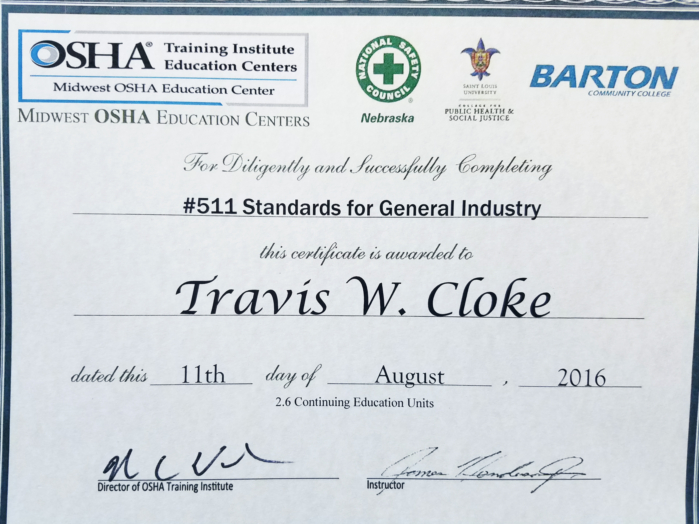
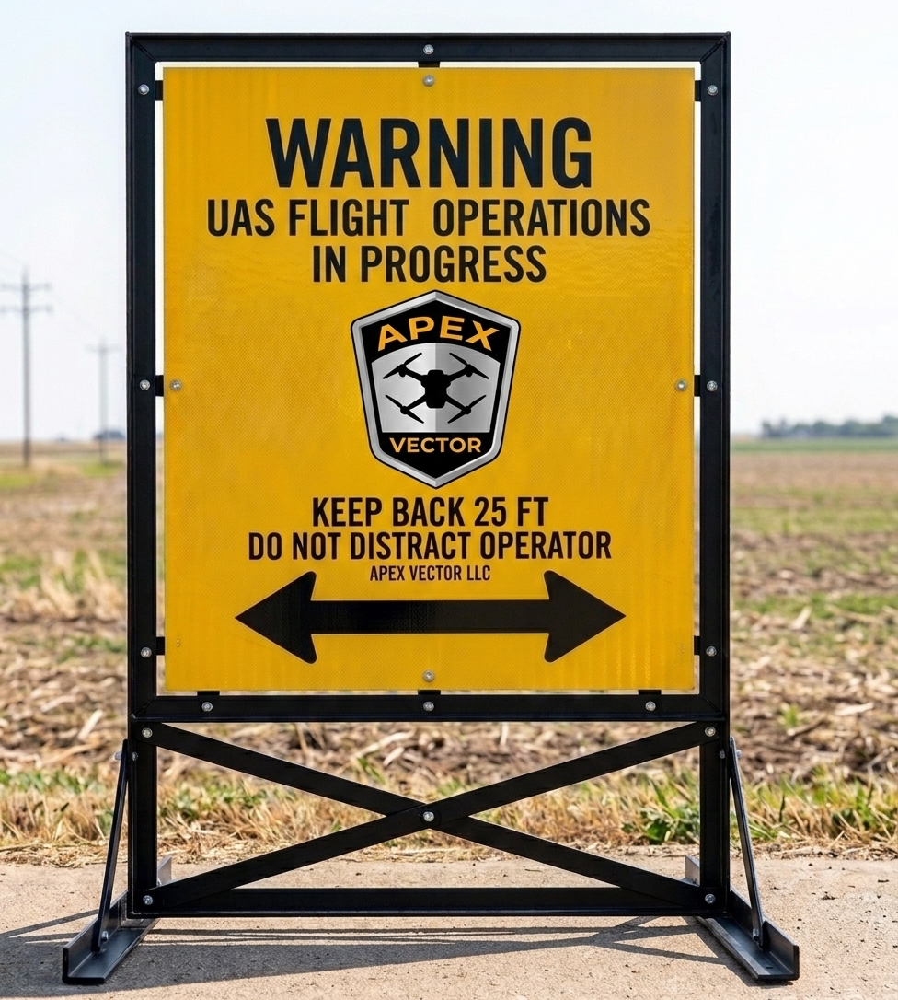
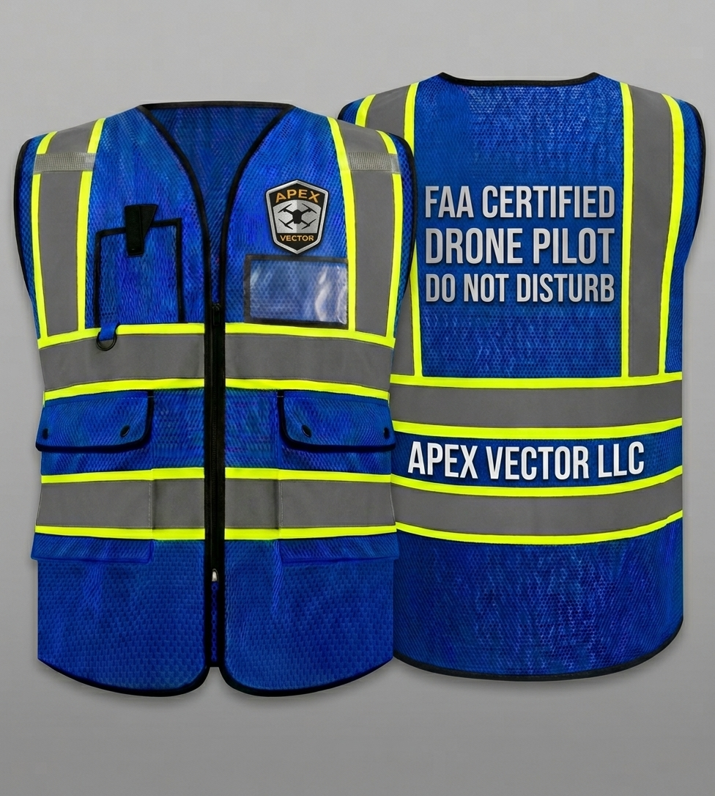
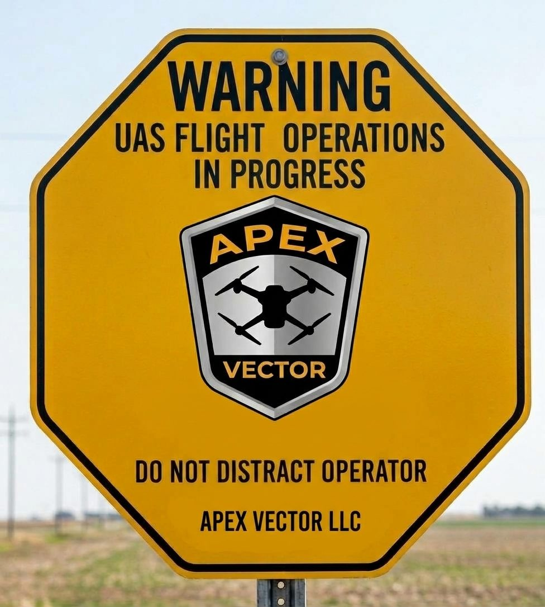

# Safety Comes First, Every Flight

Safety isn't a box I check at the end. It's how every job is planned, from the first phone call to the last landing.

## 🎖️ Built on Army Aviation Habits

I spent 10 years in the U.S. Army as a **CH-47 Chinook Helicopter Repairer and aircrew member**. On a Chinook, nothing flies until the inspections are done and signed off. I run my drones the same way: every aircraft and battery gets a pre-flight and post-flight check, and every check goes in the logbook.

---

### 📜 Safety Training

Drone work often happens on job sites, farms, and industrial property that run their own safety programs. My training helps me fit right in with yours.

*   **Credential:** OSHA #511, Standards for General Industry
*   **Issued by:** Midwest OSHA Education Centers / National Safety Council / Barton Community College
*   **Hours:** 2.6 Continuing Education Units covering compliance, hazard identification, and site risk.

I'm glad to work alongside your safety director, project manager, or foreman, and follow your site rules.

---

## 🛑 Marked Safety Boundaries

Every takeoff and landing area gets two marked zones. Nobody who isn't part of the flight goes inside them while the aircraft is armed.

1.  **15-foot inner zone**  
    *Around the landing pad and the pilot's controller. Pilot only.*
2.  **25-foot outer boundary**  
    *Keeps bystanders, vehicles, and equipment at a safe distance. Anyone is welcome to watch from outside it.*

---

## 🦺 Gear You'll See on Site

Clear signs and gear make the boundaries obvious to everyone, from your crew to a neighbor who stops by.
<!-- FIELD OPERATIONAL VISUAL CONTROLS BLOCK -->

  

    <h4 style="margin-top: 0; color: #24292e;">🚧 Boundary Signs</h4>
    
    
Heavy-duty, high-visibility signs set up along the 25-foot outer boundary so everyone on site knows where the line is.

  

  

    <h4 style="margin-top: 0; color: #24292e;">🦺 Pilot Identification</h4>
    
    
An ANSI Class 3 high-visibility vest, so the pilot is easy to spot on a busy site and people know not to walk up mid-flight.

  

  

    <h4 style="margin-top: 0; color: #24292e;">🛩️ Pilot Station Signs</h4>
    
    
"Do Not Distract Operator" signs around the pilot's position. A pilot watching the aircraft shouldn't be fielding questions at the same time.

  

---

## 🛩️ Airspace & the Pilot's Final Say

Hutchinson sits right next to **Hutchinson Regional Airport (KHUT)** and its controlled airspace, so knowing the airspace is part of every job.

*   **The pilot has final authority.** Under FAA rules (14 C.F.R. &sect; 107.19), the Remote Pilot in Command decides whether a flight goes. If someone walks into a safety zone, the aircraft holds position or comes back immediately.
*   **Weather and air traffic.** Flights are paused or rescheduled if wind, visibility, or manned aircraft near KHUT make it unsafe.

---

## 📋 A Scored Risk Check Before Every Launch

Before every takeoff I score the flight on 11 risk factors, including pilot readiness, aircraft condition, airspace, wind, visibility, and people or livestock nearby. If any single critical factor fails, the aircraft stays on the ground, no matter how good everything else looks. That rule isn't bent on site.

The result: your data gets collected efficiently, legally, and with your site's safety first.
